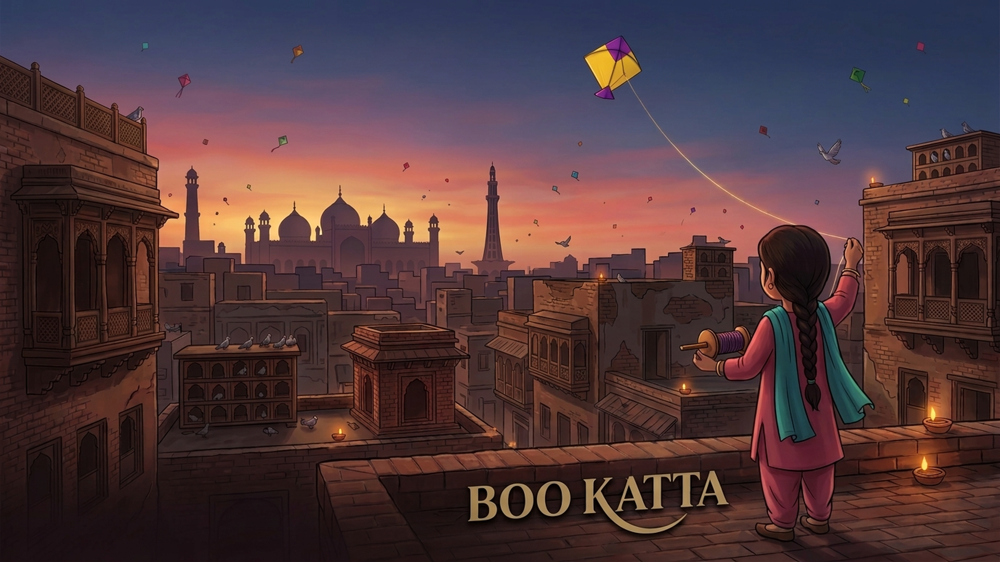
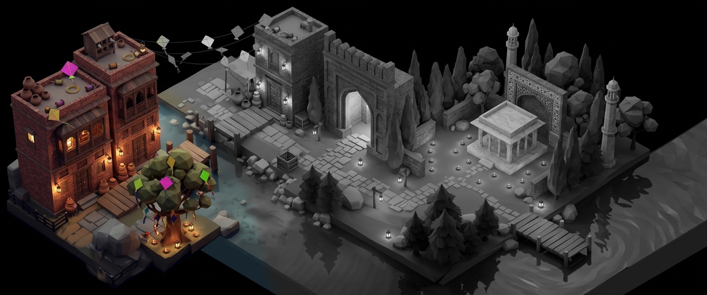
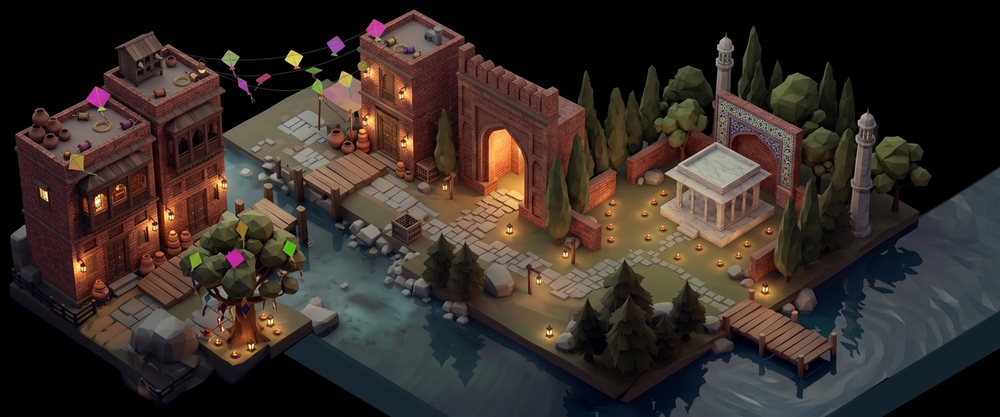

<div align="center">



# Bo Katta!

**A 2D narrative puzzle adventure set over the rooftops of Lahore during Basant.**

[](https://faroghzahra.itch.io/bo-katta)


### ▶️ [Play it now on itch.io](https://faroghzahra.itch.io/bo-katta)

</div>

---

## About

*"Bo Katta!"* is the cry that rings out across Lahore's rooftops when a kite's string is cut during Basant, the spring kite festival.

Follow **Noor** through a Lahore diorama. Hunt for scraps of kite paper hidden around the neighbourhood, nudge aside the obstacles in your way, and solve tactile paper-craft puzzles. Each one you finish brings back a little more colour to the city.

<div align="center">

&nbsp;

<br/><sub>The diorama gains colour as you progress</sub>
</div>

## Features

- **Exploration and collection.** Noor walks a set path through the city. Click rocks, trees, doors and barrels to reveal hidden kite-paper scraps and a golden item in each level.
- **Fold It puzzles.** Swipe to fold paper flaps in the right order. Fold in the wrong order and the paper unfolds back to the start.
- **Kintsugi shard puzzles.** Fit broken pieces back together and trace the glazed seams that join them.
- **Three levels plus a finale.** A mended bridge, a rescued pigeon and a repaired *kishti* (boat) that sails Noor onward.

## How to Play

| Action | Control |
|---|---|
| Move obstacles / collect items | **Click** |
| Fold paper (Fold It) | **Swipe** in the direction of the fold |
| Assemble shards / trace seams (Kintsugi) | **Click & drag** |

Collect every scrap **and** the golden item in a level to unlock its puzzle.

## Running the Project Locally

### Requirements
- [Unity Hub](https://unity.com/download)
- **Unity 2022.3.62f2 (LTS)**
- Visual Studio or JetBrains Rider (optional, for scripting)

### Setup
```bash
git clone https://github.com/FaroghZahra/Bo-Katta.git
```
1. Open **Unity Hub**, choose **Add → Add project from disk**, and select the cloned folder.
2. Open `Assets/Scenes/MainScene.unity`.
3. Press **Play**.

### Building
Go to **File → Build Settings** and add the scenes in this order:

| Index | Scene |
|---|---|
| 0 | `MainScene` |
| 1 | `MiniGameScene` |
| 2 | `FoldItScene` |
| 3 | `Kitsungi` |

## Project Structure

```
Assets/
├── Scripts/
│   ├── Core/               # Static event bus (GameEvents), camera fitting
│   ├── MainScene/          # Character movement, collectibles, moveables, level flow, rewards
│   ├── MiniGame/           # Sequences the minigames inside MiniGameScene
│   ├── MiniGameFoldIt/     # Paper-folding puzzle
│   └── MiniGameKintsugi/   # Shard assembly + seam tracing puzzle
├── Resources/
│   ├── FoldIt/             # Level1–3.json puzzle definitions
│   └── Kintsugi/           # Level1–3.json puzzle definitions
├── Scenes/                 # MainScene, MiniGameScene, standalone puzzle scenes
├── Sprites/                # Lahore backgrounds, characters, objects, collectibles, UI
└── Sounds/                 # Music and SFX
```

### Architecture at a glance
- **`MainScene`** is the hub. The character walks a waypoint path. Breakpoints activate obstacles, and collecting everything opens the minigame.
- **`MiniGameScene`** loads **additively** on top of the hub. When the puzzle is solved it fires `GameEvents.MinigameWon()` and unloads.
- **`LevelProgressionController`** handles what happens after each win: background swaps, reward cutscenes and the next set of collectibles.
- Puzzle layouts are **data-driven**. Each level is a JSON file in `Assets/Resources/`, so you can add or tweak levels without touching code.

See [`SCRIPTS.md`](SCRIPTS.md) for a per-script API reference.

## Built With
- [Unity 2022.3 LTS](https://unity.com/)
- [DOTween](http://dotween.demigiant.com/) for tweening and animation
- [TextMeshPro](https://docs.unity3d.com/Packages/com.unity.textmeshpro@latest) for UI text
- Unity 2D feature set (Sprites, Tilemaps, 2D Animation)

## Author

**Farogh Zahra** · [GitHub](https://github.com/FaroghZahra) · [itch.io](https://faroghzahra.itch.io)

---

<div align="center">

**[🪁 Play Bo Katta! on itch.io](https://faroghzahra.itch.io/bo-katta)**

</div>
